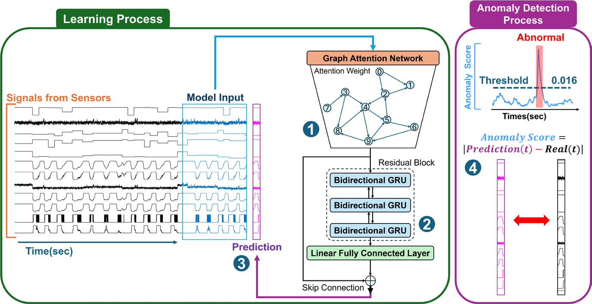

# GE-BiGRU: Graph-Enhanced Bidirectional GRU for Anomaly Detection in Power Generation Environments

Official code for the paper:

> Dongwook Kwon, Youngshin Kang, Jiwoon Lee, Yusang Nam, Jihwan Won, Ko Keun Kim, Dan Dongseong Kim, Cheolsoo Park.
> **Graph-enhanced bidirectional GRU for anomaly detection in power generation environments.**
> *Data Mining and Knowledge Discovery* 40, 102 (2026). https://doi.org/10.1007/s10618-026-01262-3



*Figure: prediction-based anomaly detection framework (Fig. 3 of the paper, CC BY 4.0).*

## Overview

GE-BiGRU is a prediction-based anomaly detector for multivariate time series from industrial control systems:

- The model is trained on normal operation only. From a 39-step window it predicts the next value of all 79 sensors and actuators, and the anomaly score is the mean absolute prediction error.
- A graph layer models the relations between sensors using a binary adjacency matrix derived from the piping and instrumentation diagrams (P&ID) of the HAI testbed (`data/graph/graph.csv`). Its output feeds a 3-layer bidirectional GRU with a residual connection.
- The detection threshold is selected on a validation split by maximizing the eTaPR F1 score, then fixed for the test split.

The code covers all 16 variants compared in the paper (Tables 4–6): LSTM or GRU, unidirectional or bidirectional, with no graph layer or with a GNN, GCN, or GAT layer.

| Graph layer | Implementation |
|---|---|
| GNN | Neighbor aggregation with the row-normalized adjacency (D⁻¹A), followed by a learnable linear map |
| GCN | `torch_geometric.nn.GCNConv` |
| GAT | `torch_geometric.nn.GATConv` (single head); the learned attention matrix is exported for interpretation |

## Results

HAI 21.03, 45 test attacks. Bidirectional models from Table 5 of the paper:

| Model | Sensitivity | Specificity | TaP | TaR | F1 |
|---|---|---|---|---|---|
| Bi-GRU | 0.720 | 0.995 | 0.933 | 0.854 | 0.892 |
| **Bi-GRU+GNN** | 0.752 | 0.994 | 0.940 | 0.909 | **0.924** |
| Bi-GRU+GCN | 0.724 | 0.994 | 0.921 | 0.893 | 0.907 |
| Bi-GRU+GAT | 0.694 | 0.996 | 0.972 | 0.843 | 0.903 |

F1 is the harmonic mean of TaP and TaR. Unidirectional and LSTM variants are reported in the paper. No random seed is fixed, so retrained results can differ slightly from these numbers.

## Setup

```bash
git clone https://github.com/dongwooky/GE-BiGRU.git
cd GE-BiGRU
pip install -r requirements.txt
```

For GPU training, install the PyTorch build that matches your CUDA version first ([instructions](https://pytorch.org/get-started/locally/)). The paper's experiments used PyTorch 2.1.0 with CUDA 12.1 on one NVIDIA RTX 6000 Ada GPU. The code also runs on CPU, but training is slow.

## Data

The HAI 21.03 dataset ([Shin et al., 2021](https://doi.org/10.1145/3474718.3474719)) is available from the official repository: https://github.com/icsdataset/hai

```bash
cd code
python download_data.py
```

This downloads `train1–3.csv.gz` into `data/train/` and `test1–5.csv.gz` into `data/test/`. Uncompressed `.csv` files work as well.

| Split | Files | Attacks | Use |
|---|---|---|---|
| Train | train1–3 | none | model training (normal operation only) |
| Validation | test1 (first 43,201 rows of the test files) | 5 | threshold selection only |
| Test | test2–5 | 45 | evaluation |

`data/graph/graph.csv` is the 79×79 binary adjacency matrix. Rows and columns follow the sensor column order of the HAI 21.03 files (Tables 1–2 in the paper).

## Usage

Run all scripts from `code/`:

```bash
cd code

# Quick check without data: builds all 16 models and compares parameter counts with Table 6
python test_models.py

# Train and evaluate one model
python train.py --model Bi-GRU+GNN
python predict.py --model Bi-GRU+GNN

# All 16 variants, or a subset
python run_experiments.py
python run_experiments.py --models Bi-GRU Bi-GRU+GNN Bi-GRU+GAT
```

Model names: `LSTM`, `GRU`, `LSTM+GNN`, `GRU+GNN`, `LSTM+GCN`, `GRU+GCN`, `LSTM+GAT`, `GRU+GAT`, and the same names with a `Bi-` prefix.

Outputs:

- `model/saved_model_<MODEL>.pt`: trained weights
- `result/<MODEL>/`: logs, anomaly score plots, per-channel heatmaps and scores, `efficiency.json`, and for GAT models the learned attention matrix (`adj_matrix.csv`)
- `logs/<run_id>/summary.md`: result tables in the format of the paper (from `run_experiments.py`)

Training time per model on one RTX 6000 Ada ranges from about 20 minutes (GRU) to about 16–17 hours (GAT variants); see Table 6 of the paper.

## Hyperparameters

Defined at the top of `train.py` and `predict.py`, identical for all variants:

| Parameter | Value |
|---|---|
| Window | 40 steps (39 input steps → next step), stride 1 |
| RNN | 3 layers, hidden size 100 |
| Training | 70 epochs, batch size 512, AdamW (default lr = 1e-3), MSE loss |
| Preprocessing | min–max scaling with training statistics, EMA smoothing (α = 0.9) |
| Score smoothing | first-order low-pass Butterworth filter (cutoff 0.1, zero-phase) |
| Threshold | 200 evenly spaced candidates over the smoothed validation scores; the largest threshold within 0.01 of the best validation eTaPR F1 is used |

## Citation

If you use this code, please cite:

```bibtex
@article{kwon2026gebigru,
  title   = {Graph-enhanced bidirectional {GRU} for anomaly detection in power generation environments},
  author  = {Kwon, Dongwook and Kang, Youngshin and Lee, Jiwoon and Nam, Yusang and Won, Jihwan and Kim, Ko Keun and Kim, Dan Dongseong and Park, Cheolsoo},
  journal = {Data Mining and Knowledge Discovery},
  volume  = {40},
  pages   = {102},
  year    = {2026},
  doi     = {10.1007/s10618-026-01262-3}
}
```

Please also cite the HAI dataset ([Shin et al., CSET '21](https://doi.org/10.1145/3474718.3474719)) and eTaPR ([Hwang et al., SAC '22](https://doi.org/10.1145/3477314.3507024)) if you use them.

## License

The code in this repository is released under the [MIT License](LICENSE). The HAI dataset and [eTaPR](https://github.com/saurf4ng/eTaPR) are distributed by their authors under their own licenses.
